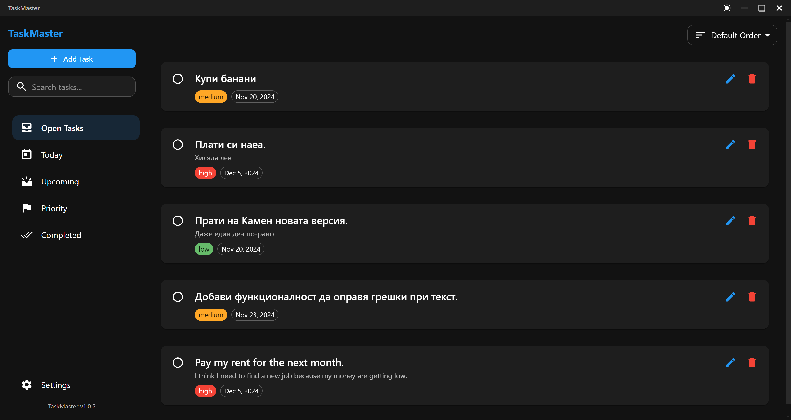

# TaskMaster - Modern Task Management Application

[](https://github.com/dmdavidkov/taskmaster/blob/main/LICENSE)
[](https://github.com/dmdavidkov/taskmaster/releases)
[](https://www.electronjs.org/)
[](https://reactjs.org/)
[](https://vitejs.dev/)

A beautiful and responsive task management application built with Electron and React. TaskMaster helps you organize your work and life with a clean, modern interface and powerful features, including AI-powered task creation.



## Key Features

- **Create, edit, and delete tasks**: Effortlessly manage your to-do list.
- **Set due dates and priorities**: Stay on top of your deadlines.
- **Organize with categories**: Keep your tasks neatly organized.
- **Search and filter**: Quickly find the tasks you're looking for.
- **Dark/Light Mode**: Switch between dark and light themes for your comfort.
- **AI-Powered Task Creation**: Use AI to automatically generate tasks from your voice or text input.
- **Voice-to-Text with Whisper**: Dictate your tasks using the powerful Whisper AI model.
- **Local Data Persistence**: Your data is saved locally on your device.
- **Auto-updates**: The application automatically updates to the latest version.
- **Responsive Design**: Enjoy a seamless experience across different screen sizes.

## Tech Stack

### Core
- **[React 18.2.0](https://reactjs.org/)**: A JavaScript library for building user interfaces.
- **[Electron 34.0.0-beta.4](https://www.electronjs.org/)**: A framework for creating native applications with web technologies.
- **[Vite 5.1.0](https://vitejs.dev/)**: A fast build tool and development server for modern web projects.

### UI and Styling
- **[Material-UI 5](https://mui.com/)**: A popular React UI framework.
- **[Framer Motion](https://www.framer.com/motion/)**: A library for creating animations in React.
- **[@emotion/react](https://emotion.sh/docs/introduction)**: A library for writing CSS styles with JavaScript.

### State Management
- **[Zustand](https://github.com/pmndrs/zustand)**: A small, fast, and scalable state-management solution for React.

### AI and Machine Learning
- **[@huggingface/transformers](https://huggingface.co/docs/transformers.js/index)**: State-of-the-art machine learning for Node.js.
- **[OpenAI](https://openai.com/)**: API for accessing powerful AI models.
- **[Groq SDK](https://wow.groq.com/sdks-and-api/)**: SDK for the Groq AI inference engine.

### Tooling and Utilities
- **[Electron Builder](https://www.electron.build/)**: A complete solution to package and build a ready for distribution Electron app.
- **[Electron Updater](https://www.electron.build/auto-update)**: A solution for auto-updates in Electron applications.
- **[Electron Store](https://github.com/sindresorhus/electron-store)**: A simple data persistence solution for Electron.
- **[Date-fns](https://date-fns.org/)**: A modern JavaScript date utility library.
- **[UUID](https://github.com/uuidjs/uuid)**: A library for generating RFC4122 UUIDs.

## Getting Started

### For Users

1.  Download the latest installer from the [Releases](https://github.com/dmdavidkov/taskmaster/releases) page.
2.  Run the `TaskMaster.Setup.exe` installer.
3.  Follow the installation wizard to complete the setup.
4.  Launch TaskMaster from your desktop or start menu.

### For Developers

**Prerequisites:**

*   [Node.js](https://nodejs.org/) (version >=22.10.0)
*   [Git](https://git-scm.com/)

**Installation:**

1.  Clone the repository:
    ```bash
    git clone https://github.com/dmdavidkov/taskmaster.git
    cd taskmaster
    ```

2.  Install the dependencies:
    ```bash
    npm install
    ```

3.  Start the development server:
    ```bash
    npm run dev
    ```
    This will start the application with hot reload enabled. Changes in the `src` directory will be reflected in real-time. Changes to the main Electron process require an application restart.

## Build and Distribution

You can build the application for different purposes using the following scripts:

-   **Create a development build:**
    ```bash
    npm run build
    ```

-   **Create a portable Windows version:**
    ```bash
    npm run make-win
    ```

-   **Create a Windows installer:**
    ```bash
    npm run make-installer
    ```
    The generated installer will be located in the `dist` directory.

## Project Structure

```
taskmaster/
├── build/                 # Build output
├── dist/                  # Packaged application and installer
├── electron/              # Electron main process files
│   ├── electron.js        # Main Electron process
│   └── preload.js         # Electron preload script
├── public/                # Static assets for the renderer process
├── src/                   # React application source code
│   ├── components/        # React components
│   ├── hooks/             # Custom React hooks
│   ├── services/          # Application services
│   ├── stores/            # Zustand state stores
│   ├── workers/           # Web workers
│   ├── App.js             # Main React component
│   └── index.js           # React entry point
├── assets/                # Application assets (icons, images)
├── scripts/               # Utility scripts
├── .env.example           # Example environment file
├── electron-builder.yml   # Electron Builder configuration
├── package.json           # Project metadata and dependencies
└── vite.config.js         # Vite configuration
```

## Contributing

Contributions are welcome! If you have a feature request, bug report, or want to contribute to the code, please follow these steps:

1.  Fork the repository.
2.  Create a new feature branch (`git checkout -b feature/AmazingFeature`).
3.  Commit your changes (`git commit -m 'Add some AmazingFeature'`).
4.  Push to the branch (`git push origin feature/AmazingFeature`).
5.  Open a Pull Request.

## License

This project is licensed under the MIT License. See the [LICENSE](LICENSE) file for details.

## Acknowledgments

-   [Electron](https://www.electronjs.org/)
-   [React](https://reactjs.org/)
-   [Material-UI](https://mui.com/)
-   [Vite](https://vitejs.dev/)
-   [Framer Motion](https://www.framer.com/motion/)

---

Made with ❤️ by Dimitar Davidkov
